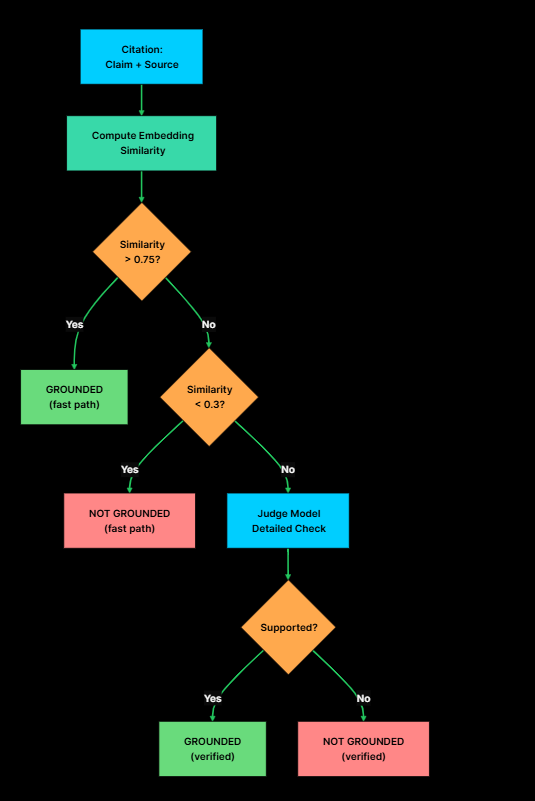

# RAG with Citations and Grounding

Citation: “Here is the source I used.”
Grounding: “This source actually supports the claim I made.”

## Normal RAG pipeline
```
User question
      ↓
Retrieve documents
      ↓
Give documents + question to LLM
      ↓
LLM generates answer
```

add reliability layer

```
User question
      ↓
Retrieve documents
      ↓
Generate cited answer
      ↓
Structured output
      ↓
Verify citations
      ↓
Check faithfulness
      ↓
Calculate confidence
      ↓
Answer / partial answer / abstain
```
## The Citation Generation Pipeline
```
User question
      ↓
Retrieve documents
      ↓
Number and Format sources
      ↓
Model generates cited response
      ↓
Parse into pydantic model
      ↓
Verify citations
      ↓
Cited Answer + Confidnece socre
```


